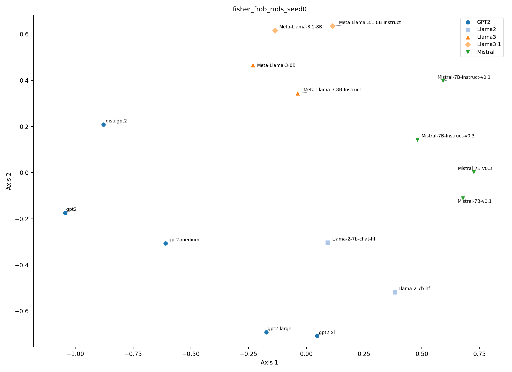
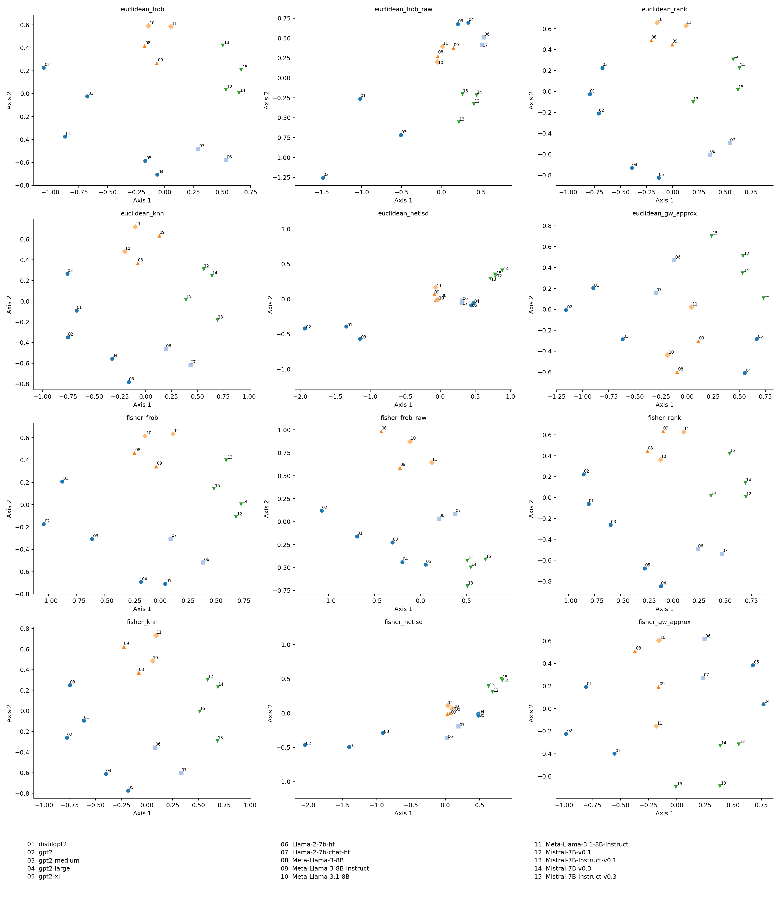
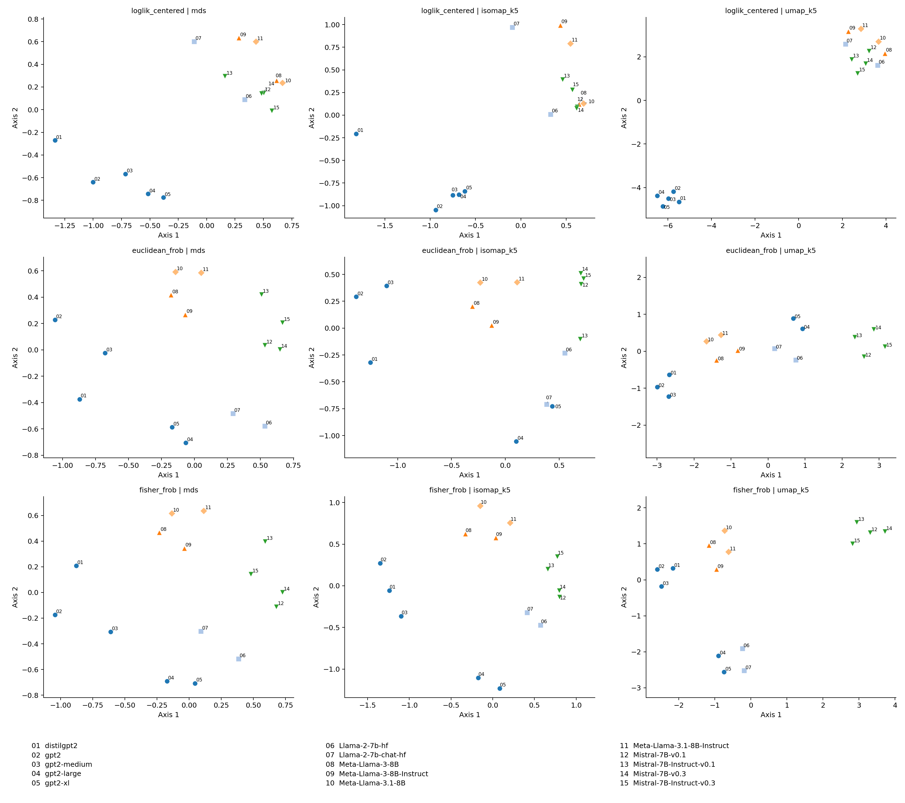

# LLM_atras

100モデルでのShimodairaらの尤度法とグラフ法の対照実験については、
[実験プロトコル](experiments/100models/PROTOCOL.md)と
[モデル一覧](configs/models_100.json)を参照してください。共通300テキスト上の手法追試であり、原論文の全データの再現とは区別します。

LLMの内部表現から近傍グラフを作り、モデル間距離と2次元のモデル地図を比較する研究用Pythonライブラリです。

```text
共通テキスト → 各モデルの内部表現・局所計量 → テキスト近傍グラフ
            → モデル間距離行列 → MDS / Isomap / UMAP → 定量評価
```



## インストール

Python 3.10以上を使います。モデルの重みと入力コーパスは含まれていません。

```bash
git clone git@github.com:0xikkkun/LLM_atras.git
cd LLM_atras
python -m pip install -e .
```

コアの幾何計算はCPUで利用できます。抽出・可視化・テストを含める場合は以下を使います。

```bash
python -m pip install -e '.[models,analysis,dev]'
python -m pytest -q
llm-atras selftest
python examples/synthetic_map.py
```

モデル抽出はCUDA GPUを使用します。元の実験はPyTorch 2.5.1、Transformers 5.8.0、scikit-learn 1.7.2で実行しました。

## Python API

```python
import numpy as np
from llm_atras import graph_distances, normalize, classical, align

rng = np.random.default_rng(0)
eta = rng.normal(size=(60, 4))
metrics = np.broadcast_to(np.eye(4), (60, 4, 4)).copy()

graphs, components = graph_distances(eta, metrics, k=10)
if components != 1:
    raise ValueError("Choose a connected graph configuration")
S = normalize(graphs['fisher']['S'])
coordinates = classical(S)
aligned, R, residual = align(coordinates, coordinates, rotation_only=True)
```

主なAPI:

| API | 内容 |
|---|---|
| `graph_distances(X, metrics, k)` | 共通のunion kNN接続に、ユークリッド／Fisher辺重みを付けて最短経路距離を計算 |
| `cka_distance(features)` | 中心化Gram行列を正規化した特徴間のユークリッド距離 |
| `rank_distance(matrices)` | 距離行列の順位相関に対応するchord距離 |
| `knn_distance(matrices, k=10)` | 対応する入力の近傍集合の不一致 |
| `netlsd_vector(graph)` | 正規化ラプラシアンの多スケールheat-trace特徴 |
| `classical(D)` | 古典的MDSによる2次元配置 |
| `align(X, reference, rotation_only=False)` | 中心化とProcrustes整列。拡大縮小はしない |
| `assess(D, coordinates)` | ストレス、距離順位相関、近傍保存率 |
| `metric_audit(D)` | 有限性、対称性、非負性、対角、三角不等式の数値チェック |

`align`の既定値は鏡映も許します。`rotation_only=True`で行列式が+1の回転に制限できます。形状の違いは回転では取り除きません。

## 実験パイプライン

CLIは2026年10月22日の実験設定（15分野×20件、PCA 16次元、k=20、512 tokens以内）を再現するためのものです。モデルIDとキャッシュ、出力先は変更できます。モデル数は3以上にしてください。

### 1. 入力を準備する

既存のJSONを使う場合は、`texts`と`labels`を持たせ、15分野それぞれに20件以上のテキストを用意します。

```json
{"texts": ["First document", "Second document"], "labels": ["biology", "business"]}
```

上記は形式の例です。実行には15分野の件数条件を満たす入力が必要です。公開データから取得する場合:

```bash
llm-atras fetch-texts --source artifacts/balanced_source.json
```

このコマンドはネットワークを使用し、取得したデータセットrevisionを記録します。重みは別途ダウンロードしてください。以降のモデル読み込みはオフラインです。

```bash
llm-atras prepare \
  --source artifacts/balanced_source.json \
  --config configs/models.json \
  --cache-dir /path/to/huggingface/hub \
  --output artifacts
```

全モデルで同じ文字列が特殊トークンを含め512 tokens以内に収まるよう、共通のprefixを作ります。キャッシュは`--cache-dir`を複数回指定できます。省略時は`HF_HUB_CACHE`、`HF_HOME`、標準キャッシュの順に解決します。

### 2. 動作確認と主実験

```bash
# 3モデル・30テキスト。GPU番号は利用環境に合わせる
llm-atras run --output artifacts --stage smoke --gpus 0,1,2

# 15モデル・300テキスト
llm-atras run --output artifacts --stage main --gpus 0,1,2,3
```

既に完了している特徴抽出はスキップします。再開時は入力と設定を変更しないでください。

### 3. 保存済み特徴から再解析する

```bash
llm-atras analyze --output artifacts --stage main
# GWを省略する場合
llm-atras analyze --output artifacts --stage main --quick
```

モデルの再推論なしで、距離関数と次元削減を比較します。

- 距離関数の比較ではmetric MDSを使用。
- 次元削減の比較では同じモデル間距離行列を固定し、MDS、Isomap、UMAPを比較。
- モデル内部のグラフが非連結なら全モデル共通のkを増やす。
- 次元削減としてのIsomapが非連結なら、その条件を除外して記録。

## 比較する距離

対数尤度、hidden-state CKA、Value由来etaのCKAと近傍一致に加え、ユークリッド／Fisherグラフについて以下を計算します。

- 平均距離で正規化した距離行列のFrobenius距離
- 正規化しないFrobenius距離（尺度の対照）
- 距離順位のchord距離
- テキスト近傍集合の不一致
- NetLSDに着想を得たheat-trace特徴の距離
- 近似Gromov–Wasserstein構造損失の平方根

対数尤度のbyte正規化は長さの対照として別に出力し、KL近似そのものとは区別します。

## 出力

`artifacts/main/analysis/`以下に保存します。

| ディレクトリ | 内容 |
|---|---|
| `graphs/` | モデルごとのグラフ画像、整列一覧、辺、最短経路距離、整列前後の座標と行列 |
| `distances/` | 比較法ごとのモデル間距離行列（NPY・CSV） |
| `maps/` | 比較法・次元削減ごとの画像と全seedの座標 |
| `heatmaps/` | 距離行列のヒートマップ |
| `csv/` | モデルID・系列・座標を持つ、Atlasビューア用CSV |
| `evaluation/` | 距離の数値的公理チェック、系列との対応、ストレス、近傍保存率、安定性 |

## 2026年10月22日の実験

15モデル×300テキスト、17種類の比較量で707回の次元削減を実行しました。非連結のIsomap 7条件は除外しています。これらは固定した一つのモデル集合・コーパスでの結果です。





評価表は[`docs/experiments/`](docs/experiments/)にあります。系列分離の指標でFisherが一律に優位という結果ではありません。

## 数学的・実験的な範囲

- Valueとhead平均Attentionから構成する観測量は、実際のmulti-head attention出力や最終生成分布とは区別します。
- etaと共分散には同じAttention重みを使い、期待値座標では正則化した逆共分散を計量に使います。
- 異なる入力の局所計量を結ぶグラフは操作的な構成であり、全入力が共通の指数型分布族に属するという実証ではありません。
- 特徴やグラフの距離が、LLMそのものの識別性を保証するわけではありません。
- 近似GWの対称化は、厳密な距離の公理を保証しません。
- NetLSD-style実装は、Gaussian affinity・正規化ラプラシアン・128個のheat timesを使用し、原論文の全設定の再現を主張しません。
- 安定性評価は距離行列の部分集合100回とグラフ再構築20回です。後者もPCAと入力ごとの局所計量は固定しており、完全な再推定bootstrapではありません。
- 蒸留やモデルマージへの有用性は未検証です。

## 関連研究

- [Oyama et al., Mapping 1,000+ Language Models via the Log-Likelihood Vector, 2025](https://aclanthology.org/2025.acl-long.1584/)
- [Kriegeskorte et al., Representational Similarity Analysis, 2008](https://doi.org/10.3389/neuro.06.004.2008)
- [Kornblith et al., Similarity of Neural Network Representations Revisited, 2019](https://proceedings.mlr.press/v97/kornblith19a.html)
- [Huh et al., The Platonic Representation Hypothesis, 2024](https://arxiv.org/abs/2405.07987)
- [Alvarez-Melis & Jaakkola, Gromov-Wasserstein Alignment of Word Embedding Spaces, 2018](https://aclanthology.org/D18-1214/)
- [Tsitsulin et al., NetLSD, 2018](https://arxiv.org/abs/1805.10712)

Value抽出は、研究用コード`Geometry-of-Foundation-Model-Latent-Spaces`の監査済み実装を同梱しています。pre-attention LayerNorm、GPT-NeoXのQKV配置、GQAのValue展開を反映しています。
